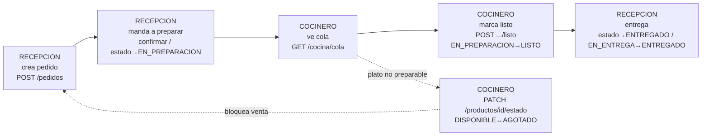

# Flujo — Recepción ↔ Cocina (operativa del restaurante)

> [!abstract] Idea en una frase
> `RECEPCION` gestiona el pedido de punta a punta (crea, manda a preparar, entrega); `COCINA` (`COCINERO`) lo prepara, lo marca listo y administra la disponibilidad de los platos; el pedido de un producto `AGOTADO` se rechaza en el dominio, no en el front.

Ver índice: [[Flujos - MOC]] · Autorización: [[Flujo - Autorizacion por Roles]] · Módulos: [[Kitchen]], [[Ordering]], [[Catalog]]

## Decisión (2026-10-02, con el dueño)

El flujo operativo acordado es este. Lo que no cumpla esta nota es bug o deuda, no "flexibilidad del front".

## Matriz de roles (fuente: `@PreAuthorize` + enums)

| Acción | Endpoint | Roles |
|---|---|---|
| Crear pedido | `POST /pedidos` | `ADMINISTRADOR, RECEPCION` |
| Mandar a preparar | `POST /pedidos/{id}/confirmar`, `PATCH /pedidos/{id}/estado` | `ADMINISTRADOR, RECEPCION` |
| Ver cola cocina | `GET /cocina/cola` | `ADMINISTRADOR, RECEPCION, COCINERO` |
| Marcar listo | `POST /cocina/pedidos/{id}/listo` (`EN_PREPARACION→LISTO`, 204) | `ADMINISTRADOR, RECEPCION, COCINERO` |
| Entregar | `PATCH /pedidos/{id}/estado` (`LISTO→ENTREGADO`, o `LISTO→EN_ENTREGA→ENTREGADO` en DELIVERY) | `ADMINISTRADOR, RECEPCION` |
| Cambiar disponibilidad de plato | `PATCH /productos/{id}/estado` (solo campo `estado`, 200) | `ADMINISTRADOR, COCINERO` |
| Edición completa de producto (precio, nombre…) | `PUT /productos/{id}` | `ADMINISTRADOR` (cocina NO entra: evita que un error cambie precios) |
| Cobrar | `POST /pagos` | `ADMINISTRADOR` (caja, fuera de este flujo) |
| Reembolsar | `POST /pagos/{id}/reembolso` (motivo obligatorio) | `ADMINISTRADOR, RECEPCION` — queda auditado quién (`reembolso_usuario_id` del JWT, nunca del JSON) y por qué (`reembolso_motivo`); ambos visibles en `PagoResponse` |

Roles `MESERO/CAJERO/REPARTIDOR`: existen en el vocabulario (`RolNombreRestaurante`, seed `V7`) sin permisos activos. Se habilitan por módulo cuando haya front que los use, no antes (YAGNI).

## Reglas del dominio

1. **Vocabulario de producto:** `DISPONIBLE / AGOTADO` (`EstadoProducto`). Es lo que hay en BD, enum y tests. El "HABILITADO/INHABILITADO" del pedido original significa esto mismo; no crear sinónimos.
2. **AGOTADO bloquea la venta en el back:** `CrearPedidoUseCase` rechaza el item con `400 "Producto no disponible: {id}"`. El front puede filtrar, pero la garantía es del dominio (anti-tamper, igual que los precios).
3. **Legado:** producto con `estado` nulo se trata como disponible (`!= AGOTADO` → vende). Cuando cocina o admin le seteen estado, queda normalizado.
4. **Tenant:** todo sale del JWT (`TenantContext`), nunca del JSON. Cross-tenant → `400/403` según el caso.
5. **Transiciones de pedido** (ver `CambiarEstadoPedidoUseCase`): `PENDIENTE → EN_PREPARACION → LISTO → ENTREGADO` (MESA/RECOJO) o `LISTO → EN_ENTREGA → ENTREGADO` (DELIVERY); `CANCELADO` hasta `LISTO`; pagado no cancelable (`400`).
6. **Los permisos se abren por rol operativo, no por usuario:** si mañana un mesero toma pedidos, se le da `RECEPCION`, no se toca código.

## Deuda conocida (no bloquea este flujo)

- `GestionarColaCocinaUseCase.marcarListo` hace `setEstado(LISTO)` directo en vez de delegar a `ordering.CambiarEstadoPedidoUseCase` (ver `PROJECT_CONTEXT §6`). Respetar al tocar cocina.
- Sin WebSockets: cocina es polling 5–10 s. Sin `MeResponse.suscripcionVigente` (banner por `GET .../actual/suscripcion`).

## Checklist

- [ ] Cada endpoint nuevo de operativa: `@PreAuthorize` según esta matriz + tenant de `TenantContext`
- [ ] Nunca exponer `restauranteId` en JSON ni confiar en el que venga del front
- [ ] `PATCH` de estado antes que `PUT` completo cuando el rol solo necesita un campo
- [ ] Contrato espejado en `servidos-frontend/front/FRONTEND_CONTEXT.md`
